<div align="center">



   

<a href="https://github.com/Kauesouzavr/portfolio/actions/workflows/codeql.yml"></a> <a href="https://github.com/Kauesouzavr/portfolio/actions/workflows/secret-scan.yml"></a>

<a href="https://portfolio-iota-six-e5leg2lg5n.vercel.app/"><b>Abrir o portfólio</b></a> &nbsp;&nbsp;&nbsp; <a href="https://www.linkedin.com/in/kauesouzaproti/"><b>LinkedIn</b></a> &nbsp;&nbsp;&nbsp; <a href="assets/CV-Kaue-Souza.pdf"><b>Currículo (PDF)</b></a>

</div>

> **In English:** my personal portfolio as a full stack developer: projects, certificates, tech stack and contact. Hand-written HTML, CSS and JavaScript, no framework and no build step, deployed on Vercel.

## O que tem no site

- **Projetos:** Central de Crédito, Bot Financeiro no WhatsApp, Prato na Mesa (cardápio em AR), Plataforma de Tips e Detecção de Fraudes, com links para a demo e o código.
- **Formação e certificados:** Bacharel em Sistemas de Informação (UGB), Nano Course de Engenharia de Software (FIAP) e Introduction to Cybersecurity (Cisco).
- **Stack, sobre mim e contato** direto por e-mail, WhatsApp e LinkedIn.

## Como foi feito

| Parte | Escolha |
| --- | --- |
| Estrutura | HTML semântico, com abas acessíveis (`role="tabpanel"`) |
| Estilo | CSS puro, tema escuro, layout responsivo |
| Interação | JavaScript puro (`js/script.js`) |
| Animação | Lottie (`assets/computer-animation.json`) |
| Hospedagem | Vercel, com deploy automático a cada push na `main` |

Sem framework e sem etapa de build: o site carrega rápido e qualquer pessoa consegue ler o código.

## Rodar localmente

Não precisa instalar nada. Abra o `index.html` no navegador ou use um servidor estático:

```bash
npx serve .
```

## Estrutura

```
index.html      Página inicial (projetos, certificados, stack, sobre, contato)
projetos.html   Página de projetos
css/style.css   Estilos
js/script.js    Abas, animações e interações
assets/         Currículo, diploma, certificados e prévias
```

---

Feito por **Kauê Souza**. Para conversar, me chame no [LinkedIn](https://www.linkedin.com/in/kauesouzaproti/).
